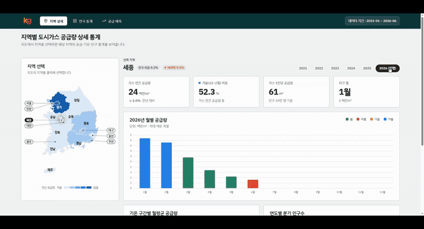
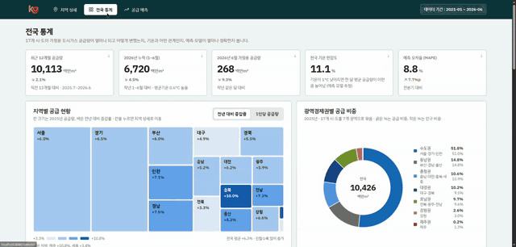
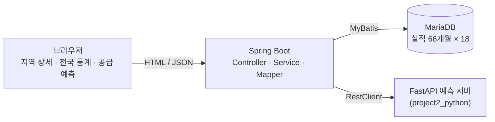
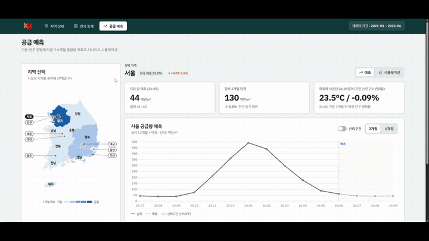
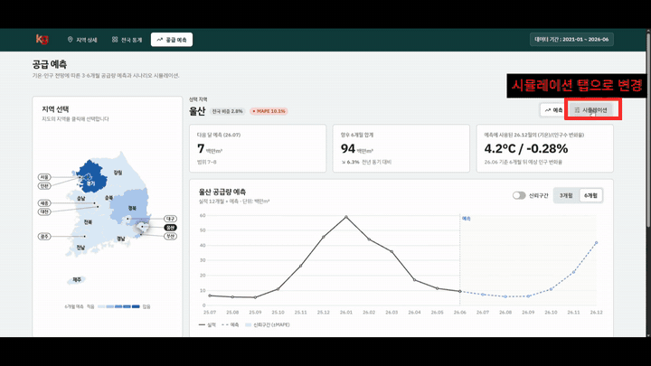

# 가스 공급량 수요 예측 모니터링 대시보드 (Spring Boot)

도시가스 공급량이 **기온 · 인구**와 어떤 관계인지 분석해 **지역 상세 · 전국 통계 · 공급 예측** 화면으로 보여 주는 대시보드입니다.  
이 저장소는 **웹(Spring Boot)** 이고, 예측 서버(FastAPI) 코드는 [project2_python](https://github.com/jinho333/project2_python)에 있습니다. 예측 서버 설명은 이 README에 함께 적었습니다. 

### 지역 상세

> 지역과 연도를 고르면 월별 공급량, 기온 구간별 공급량, 분기별 인구 차트가 바뀝니다.

### 전국 통계

> 요약 카드를 누르면 해당 차트로 이동하고, 지역별 공급 트리맵 · 권역별 비중 · 연도별 추이 · 월별 비교 · 요인 · 예측 오차를 볼 수 있습니다.

## 한눈에 보기

| | |
|---|---|
| 예측 오차(MAPE) | 전월 기온을 입력에 추가해 **18개 지역 평균 16.7% → 8.4%** (대구 62.5% → 7.3%) |
| 없는 지역 번호 | 통계 200 · 예측/시뮬레이션 500 → **404로 통일**, 공통 검증 메서드 1개 |
| 예측 속도 | 예측 결과를 캐시하고 서버 시작 시 3·6개월을 미리 계산 |
| 데이터 | (17개 시도 + 전국) × 66개월 = 1,188행 (2021.01 ~ 2026.06) |

## 기술 스택

Java 17 · Spring Boot · MyBatis · Thymeleaf · MariaDB · JavaScript(axios) · Chart.js · RestClient

## 구조

FastAPI는 **보조 서버**입니다. 지역 상세 · 전국 통계는 DB의 실제 값으로 그려, 예측 서버가 멈춰도 화면이 동작하도록 나눴습니다.

## 맡은 부분

- EDA와 예측 모델링, 대구 오차 원인 분석(공급이 기온보다 한 달 늦게 반응 → 전월 기온 추가)
- Python → MariaDB 적재 파이프라인(pymysql · SQLAlchemy)
- Spring Boot ↔ FastAPI 연동, 공급 예측 · 시뮬레이션 페이지
- **없는 지역 번호 404 처리**: API 3개가 맨 처음에 `checkRegion()`을 호출합니다. FastAPI를 부르기 전에 확인해, 어차피 거절될 요청을 보내지 않습니다.
- 비동기 응답 순서 문제 해결(요청 번호 `requestNo`로 옛 응답을 버림)

### 공급 예측

> 공급 예측 페이지: 지역을 고르면 다음 달 · 3·6개월 예측과 곡선, 예측 오차 범위가 나옵니다.

### 예측 시뮬레이션

> 시뮬레이션 탭: 기온과 인구 조건을 바꿔 보면 12개월 공급량이 다시 계산됩니다.

## 예측 서버 (FastAPI) — [project2_python](https://github.com/jinho333/project2_python)

시도별 RandomForest 모델로 다음 달 · 3·6개월 공급량을 예측하고, 기온과 인구를 바꿔 보는 시뮬레이션과 지역별 예측 오차(MAPE)를 제공합니다.

| | |
|---|---|
| 모델 | 시도별 RandomForest (R² 평균 0.924, 18개 지역 중 17곳에서 XGBoost보다 우세) |
| 입력 | 월평균기온 · **전월기온** · 총인구수 · 월 |
| 속도 | 같은 (지역, 개월) 요청은 캐시, 서버 시작 시 3·6개월 사전 계산 |

**대구 오차를 줄인 과정.** 대구의 오차(MAPE)가 60%를 넘었습니다. 공급은 기온보다 한 달 늦게 움직여 대구는 전월 기온과의 상관이 −0.96(당월 약 −0.8)로 더 강했습니다. 입력에 전월 기온을 추가해 대구 62.5% → 7.3%, 경남 23.5% → 5.7%, 강원 24.4% → 9.9%로 낮아졌습니다. 기록: [`train.py`](https://github.com/jinho333/project2_python/blob/dev/train.py#L38)

| 메서드 | 경로 | 설명 |
|---|---|---|
| GET | `/forecast?region=&horizon=` | 지역별 예측 (캐시: [`forecast_cache`](https://github.com/jinho333/project2_python/blob/dev/main.py#L66)) |
| GET | `/forecast/summary` | 지도 색칠용 요약 |
| GET | `/mape` | 지역별 예측 오차 |
| POST | `/simulation` | 기온 · 인구 시뮬레이션 (기온 → 난방도일 → 선형회귀 → × 인구) |

| 파일 | 역할 |
|---|---|
| [`prepare.py`](https://github.com/jinho333/project2_python/blob/dev/prepare.py) | 데이터 읽기, `전월기온` 등 컬럼 만들기 |
| [`train.py`](https://github.com/jinho333/project2_python/blob/dev/train.py) | 모델 학습 → `model/gas_models.pkl` 저장 |
| [`main.py`](https://github.com/jinho333/project2_python/blob/dev/main.py) | 저장된 모델로 예측하는 FastAPI 서버, 예측 캐시 |

## 기록

- [프로젝트 작업 일지 (Notion)](https://fluffy-plane-19c.notion.site/3e3a969c48278070bbaaf5dee74b31b4)
